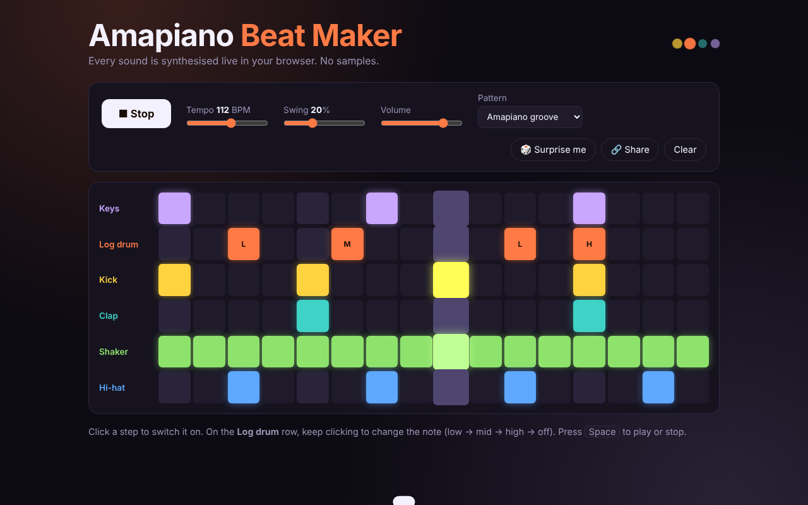
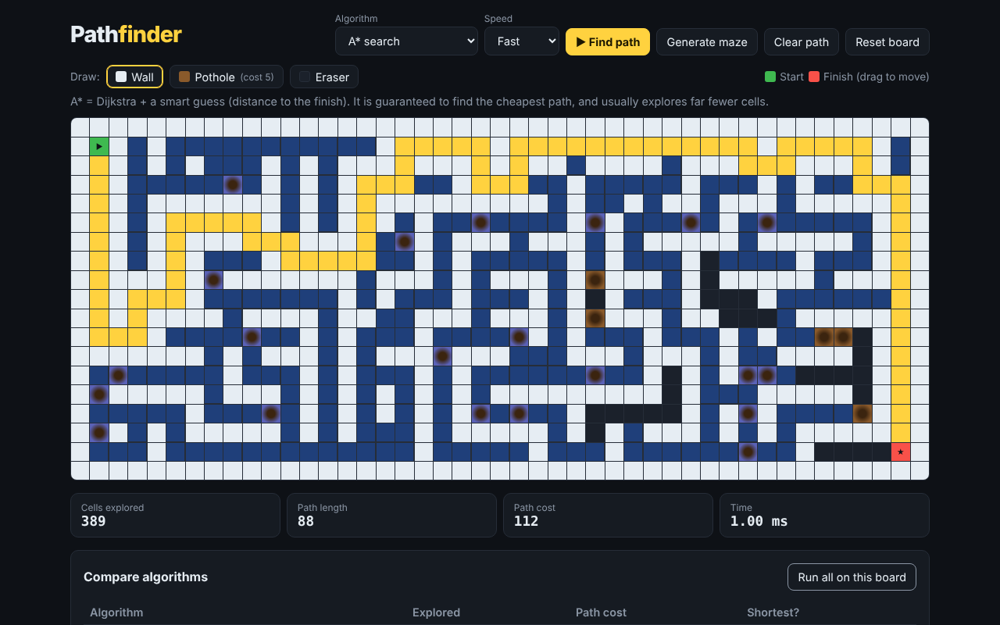
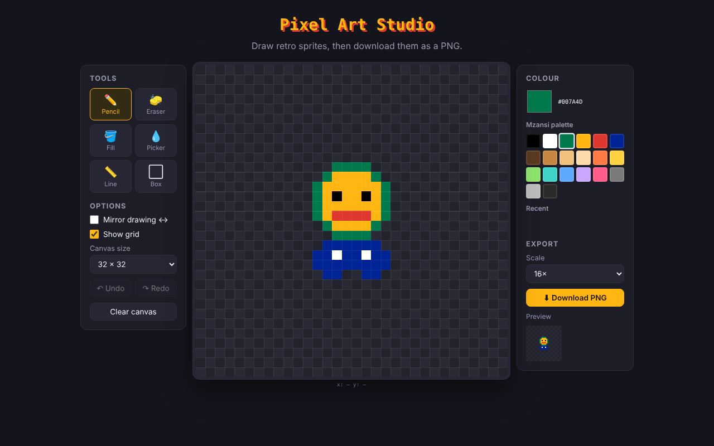
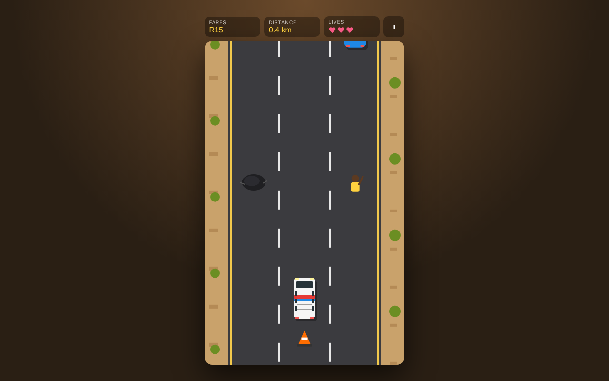

# Web Development Projects :rocket:

  

Hello fellow developers! 👋 Welcome to my **Interactive Website Project** repository, a growing collection of web apps built with HTML, CSS and JavaScript.

## About This Repository

In this repository you'll find the web development projects I'm working on. My goal is to challenge myself, improve my skills and share my progress with the community. Each project highlights different parts of web development, from DOM manipulation and timers to working with APIs and saving data in the browser.

Every project lives in its own folder with its HTML, CSS and JavaScript, plus a README explaining what it does and how it works. You can open any `index.html` directly in your browser, or host the whole repository for free with [GitHub Pages](https://pages.github.com/).

## Projects

| # | Project | What it shows |
|---|---------|---------------|
| 1 | [Hangman in Mzansi Context](HangMan%20%26%20ReadMe) | DOM, keyboard events, `localStorage` |
| 2 | [Countdown Timer](Countdown-timer) | Dates, `setInterval` |
| 3 | [Password Generator](Psssword%20Gen) | Secure randomness, Clipboard API |
| 4 | [Tic-Tac-Toe Game](Tic-Tac-Toe-Game) | Game logic, CSS Grid |
| 5 | [Marvel Characters](MarvelAPP) | `fetch`, REST API, autocomplete |
| 6 | 🤖 [Amapiano Beat Maker](AI-Revisited-Amapiano-Beat-Maker) | Web Audio API, sound synthesis, precise timing |
| 7 | 🤖 [Pathfinding Visualizer](AI-Revisited-Pathfinding-Visualizer) | A*, Dijkstra, BFS, DFS, priority queues |
| 8 | 🤖 [Pixel Art Studio](AI-Revisited-Pixel-Art-Studio) | Canvas API, flood fill, undo/redo, PNG export |
| 9 | 🤖 [Taxi Rush](AI-Revisited-Taxi-Rush) | Canvas game loop, collisions, touch controls |

### [x] #1 [Hang Man in Mzansi Context](HangMan%20%26%20ReadMe) :alien:

  

### [x] #2 [Countdown Timer](Countdown-timer) :pancakes:

  

### [x] #3 [Password Generator](Psssword%20Gen) :lock:

  

### [x] #4 [Tic-Tac-Toe Game](Tic-Tac-Toe-Game) :x::o:

  

### [x] #5 [Marvel Characters](MarvelAPP) :anatomical_heart:

  

## 🤖 AI Revisited Projects

These projects were built with the help of AI and are labelled *AI Revisited* so it's always clear which projects are my original work and which were AI-assisted. They go further than the first five, into audio, algorithms, graphics and game development.

### #6 [Amapiano Beat Maker](AI-Revisited-Amapiano-Beat-Maker) :musical_keyboard:
A 16-step drum machine where every sound, including the log drum, is synthesised live with the Web Audio API. Beats can be shared as a link.

  

### #7 [Pathfinding Visualizer](AI-Revisited-Pathfinding-Visualizer) :world_map:
Draw walls and potholes, generate mazes and watch A*, Dijkstra, BFS, Greedy and DFS race to the finish, then compare the results.

  

### #8 [Pixel Art Studio](AI-Revisited-Pixel-Art-Studio) :art:
A pixel art editor with fill, mirror mode, shapes, undo/redo and PNG export.

  

### #9 [Taxi Rush](AI-Revisited-Taxi-Rush) :minibus:
An arcade canvas game: pick up passengers and dodge potholes, cones and traffic. Works with keyboard, tap and swipe.

  

## 2026 updates to the original projects

The original five projects keep their folder structure and have been fixed and upgraded. Each README has an **"Updates (2026)"** section listing exactly what changed. Highlights:

- **Hangman:** fixed stray symbol keys on the keyboard and a word that could never be won. Added real-keyboard play, a win/loss score and new words.
- **Countdown Timer:** it was stuck counting to 2024. It now always counts to the next New Year and celebrates at midnight.
- **Password Generator:** now uses secure randomness (`crypto.getRandomValues`), shuffles the characters, has a strength meter and a readable button.
- **Tic-Tac-Toe:** fixed the background image and mobile layout. Added a winning-line highlight and a scoreboard.
- **Marvel Characters:** repaired a broken stylesheet, fixed autocomplete and added error handling and a README.
- **All projects:** absolute paths changed to relative ones so everything works on GitHub Pages, plus better accessibility and mobile layouts.

## Why build lots of small projects?

I believe consistent practice is the key to becoming a better developer. Building many small, complete projects pushes me to think critically, solve problems efficiently and combine different technologies into real, working apps.

## Join the Journey

Feel free to explore the projects, give feedback and suggest ideas for future projects. Your insights help me grow as a developer.

## Stay Connected

If you're as passionate about coding as I am, let's connect! "Star" this repository to stay updated on my latest projects.

Thank you for stopping by and being part of my coding adventure. Let's build amazing things together!

Happy coding! 😄

Best regards,
Kamogelo Masego Mashigo

## License

This repository is licensed under the [MIT License](LICENSE).
